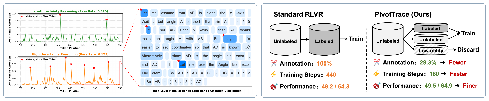

# Smart Picks in the Dark: Towards Efficient RLVR for Reasoning via Tracing Metacognitive Pivots

<p align="center">
  <a href="https://arxiv.org/abs/2606.04503"></a>
  <a href="LICENSE"></a>
  <a href="https://github.com/ZJU-DIG/DE-Venus"></a>
</p>
<h3 align="center">Less annotation · Faster training · Better performance</h3>

## Overview

This repository provides the official implementation of our NeurIPS 2026 paper [PivotTrace](https://arxiv.org/abs/2606.04503).

Our key insight is that *metacognitive pivots*, where a model revises its reasoning, attract strong long-range attention, and their frequency signals uncertainty. PivotTrace uses pivot counts to estimate uncertainty and a small labeled probing set to calibrate three-way data triage: annotate informative questions needing external supervision, self-supervise reliable ones, and discard low-utility ones. This jointly improves annotation and training efficiency.

<p align="center">
  <a href="assets/figures/motivation_teaser.png"></a>
</p>
<p align="center"><sub>Left: metacognitive pivots as an uncertainty signal. Right: PivotTrace versus standard RLVR.</sub></p>

## Getting Started

### Installation

Our implementation is based on **verl 0.5.0**. Refer to the [official installation guide](https://verl.readthedocs.io/en/v0.5.x/start/install.html) for the base FSDP + vLLM environment, then install PivotTrace with the following commands:

```bash
conda create -n pivottrace python=3.10
conda activate pivottrace

git clone https://github.com/gczhu/PivotTrace.git
cd PivotTrace
pip3 install -e ".[vllm]"
pip3 install vllm==0.8.4
pip3 install math-verify==0.8.0
pip3 install ray==2.49.0
pip3 install "traker[fast]==0.1.3"
pip3 install fire
```

### Preparation

The processed training and evaluation datasets are provided in `data/`, ready to use. The default model, Qwen3-4B-Base, requires formatting warmup before data selection and RLVR training. Download our [warmup checkpoint](https://huggingface.co/gczhu/Qwen3-4B-Warmup) to `models/Qwen3-4B-Warmup/` and proceed directly to data selection and training.

### Training

Run the following scripts in order for data selection and semi-supervised RLVR training:

```bash
bash selection/01_generate_response.sh  # Generate reasoning trajectories
bash selection/02_score_data.sh         # Trace pivots and score questions
bash selection/03_active_select.sh      # Calibrate thresholds and select data
bash train_scripts/run_semi_train.sh    # Train on labeled and unlabeled data
```

### Evaluation

In `eval_scripts/eval.sh`, use `TASK` to choose the benchmark (`math`, `arc_c`, `gpqa`, or `mmlu_pro`) and `GLOBAL_STEPS` to select checkpoints by their training steps. Then run:

```bash
bash eval_scripts/eval.sh
```

## Acknowledgments

PivotTrace is part of [DE-Venus](https://github.com/ZJU-DIG/DE-Venus), our broader framework for data-efficient LLM post-training. Our implementation builds on [verl](https://github.com/volcengine/verl), [vLLM](https://github.com/vllm-project/vllm), and [Math-Verify](https://github.com/huggingface/Math-Verify). We thank these projects and the open-source community.

## Citation

If you find this work useful, please consider citing our paper:

```bibtex
@article{zhu2026smart,
  title   = {Smart Picks in the Dark: Towards Efficient RLVR for Reasoning via Tracing Metacognitive Pivots},
  author  = {Zhu, Guangcheng and Yang, Shenzhi and Wang, Haobo and Zheng, Xing and Ma, Yingfan and Feng, Xuening and Chen, Zhongqi and Song, Bowen and Wang, Weiqiang and Chen, Gang},
  journal = {arXiv preprint arXiv:2606.04503},
  year    = {2026},
  doi     = {10.48550/arXiv.2606.04503},
  url     = {https://arxiv.org/abs/2606.04503}
}
```

## Contact

If you have any questions, please feel free to contact the authors. Guangcheng Zhu: [zhuguangcheng@zju.edu.cn](mailto:zhuguangcheng@zju.edu.cn).
